<h1 align="center">🔓 Password Cracking: JTR &amp; Networkwalks Tools</h1>

<b>Recovering passwords from three encrypted PDFs to see how weak passwords fail and why wordlist quality matters</b>

  
  
  
  
  

---

##  Project Overview

Week 3 of the Networkwalks Cybersecurity Internship has two required modules, both about recovering the password of an encrypted PDF file:

- **W3-PM1:** crack the password with **John the Ripper (JTR)** and its GUI, **Johnny**.
- **W3-PM2:** crack the password with the **Networkwalks Hash Calculator** and **Password Cracker**, two free browser-based tools.

I was given three encrypted PDFs: `My Locked PDF1.pdf`, `My Locked PDF2.pdf`, and `My Locked PDF3.pdf`. I cracked all three with JTR/Johnny, and two of the three with the Networkwalks tools. The gap between those two results turned out to be the most useful lesson of the week.

## Task Requirements

- [x] Extract a crackable hash from each encrypted PDF
- [x] Install and configure John the Ripper and Johnny
- [x] Crack all three PDFs with Johnny
- [x] Crack PDF 2 and PDF 3 with the Networkwalks Hash Calculator and Password Cracker
- [x] Confirm each password by opening the actual PDF with it

## Setup

| Component | Detail |
|---|---|
| OS | Windows 11 |
| Cracking tool | John the Ripper 1.9.0-jumbo-1 (64-bit, Cygwin, AVX2) |
| GUI | Johnny 2.2 |
| Hash extractor (PM1) | onlinehashcrack.com PDF hash extractor |
| Hash extractor (PM2) | Networkwalks Hash Calculator |
| Cracker (PM2) | Networkwalks Password Cracker (dictionary attack, built-in 100-word list) |
| Files | `My Locked PDF1.pdf`, `My Locked PDF2.pdf`, `My Locked PDF3.pdf` |

I installed Johnny and pointed it at John's executable, inside the `run` folder of the JTR download, since Johnny only drives the attack and needs John itself to do the cracking.

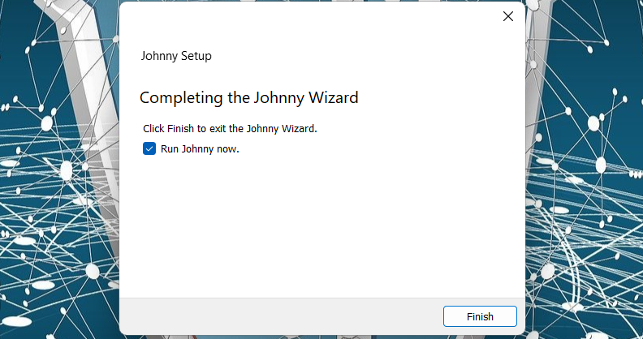
*Figure 1: Finishing the Johnny setup wizard.*

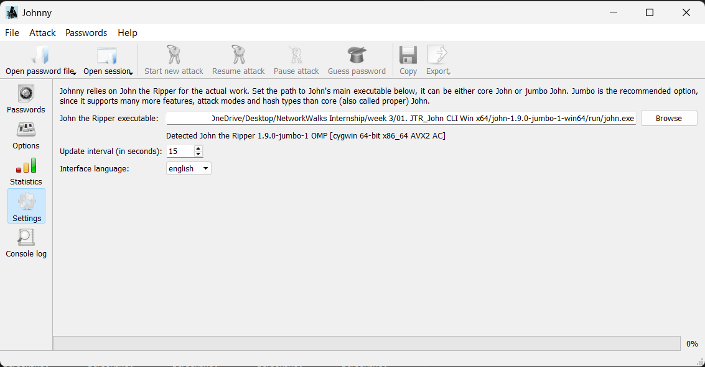
*Figure 2: Johnny's Settings tab, pointed at `john.exe` inside the JTR install folder. Johnny detected it as "John the Ripper 1.9.0-jumbo-1 OMP".*

## W3-PM1: Password Cracking with JTR

The idea is simple: a password-protected PDF doesn't store the password itself, it stores a hash derived from it. Pull out that hash with an extractor tool, hand it to John the Ripper, and let it try passwords until one produces a matching hash.

### PDF 1

I uploaded `My Locked PDF1.pdf` to the online hash extractor and got back a hash starting `$pdf$4*4*128*-1028*1*16*ca7f72f1...`.

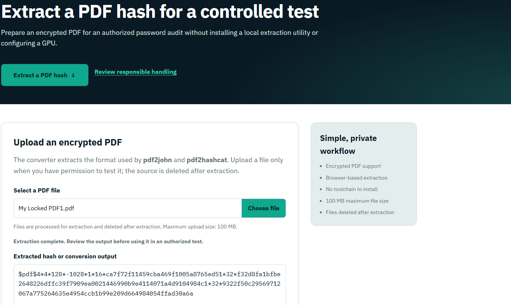
*Figure 3: Extracted hash for PDF 1.*

I saved the hash into a text file, opened it in Johnny, and started the attack. It cracked almost immediately.

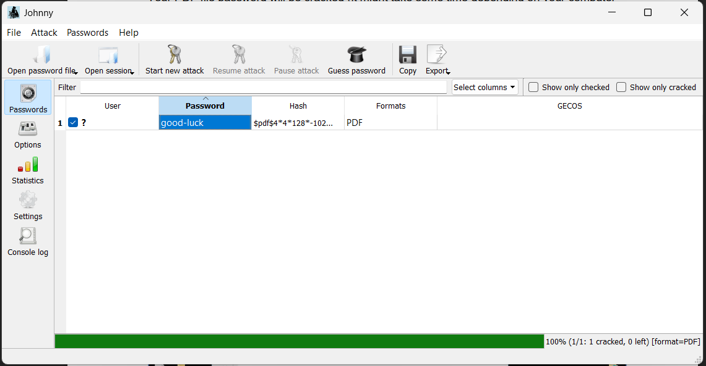
*Figure 4: Johnny recovers the password `good-luck` for PDF 1.*

Entering `good-luck` opened the file and revealed the flag:

*Figure 5: PDF 1 unlocked, flag `nw{cybersecurity_flag_captured_2608}`.*

### PDF 2

Same process: extract the hash, feed it to Johnny.

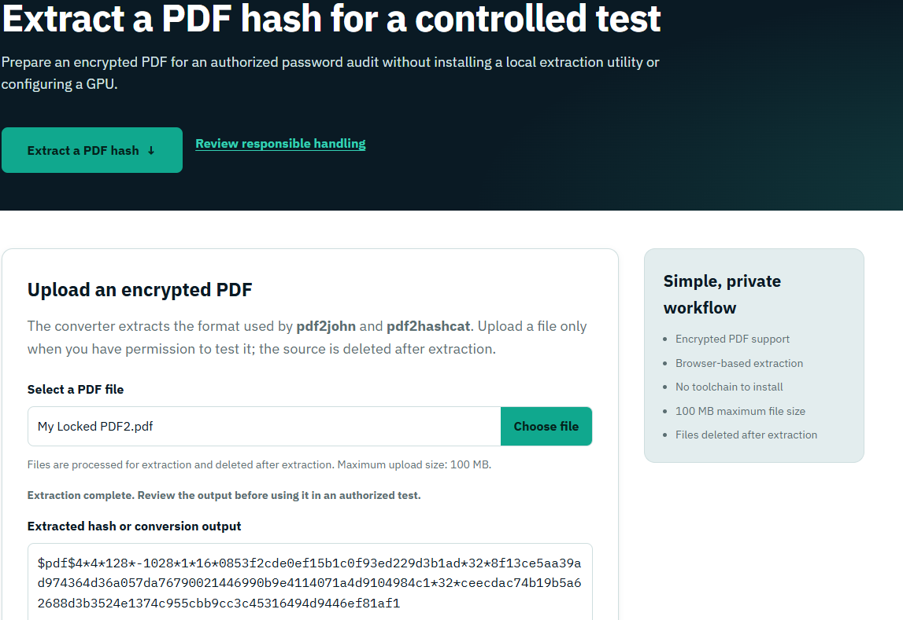
*Figure 6: Extracted hash for PDF 2.*

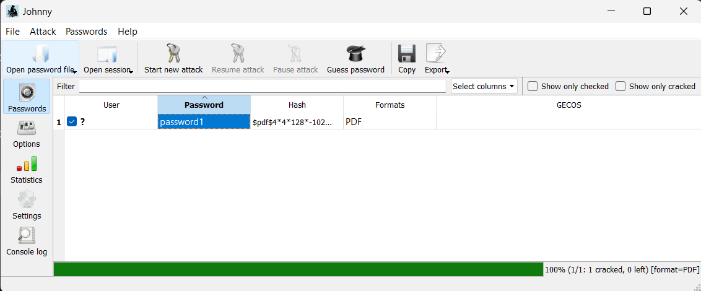
*Figure 7: Johnny recovers the password `password1` for PDF 2.*

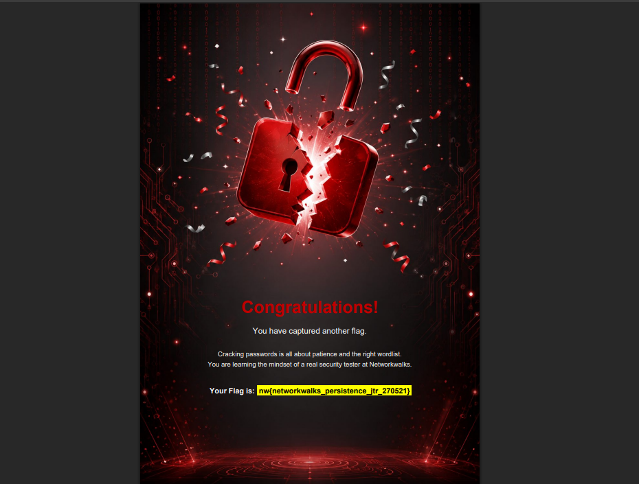
*Figure 8: PDF 2 unlocked, flag `nw{networkwalks_persistence_jtr_270521}`.*

### PDF 3

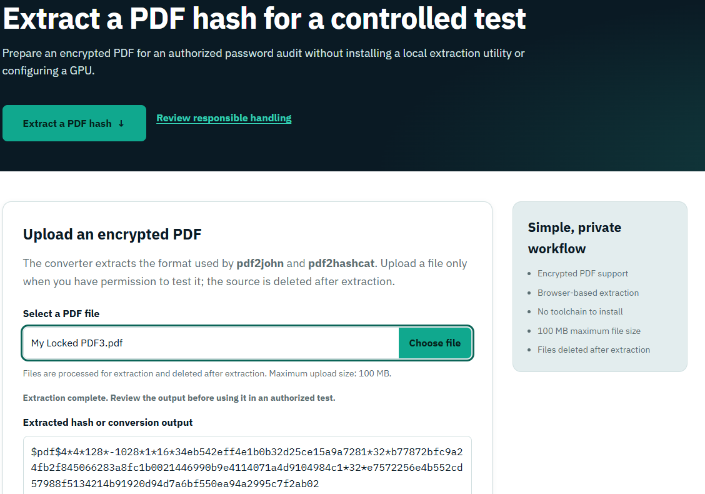
*Figure 9: Extracted hash for PDF 3.*

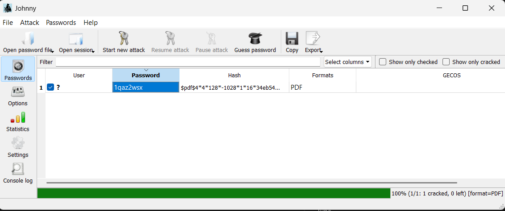
*Figure 10: Johnny recovers the password `1qaz2wsx` for PDF 3.*

*Figure 11: PDF 3 unlocked, flag `nw{networkwalks_flag_260821_1}`.*

### PM1 Summary

| File | Hash prefix | Password | Flag |
|---|---|---|---|
| My Locked PDF1.pdf | `$pdf$4*4*128*-1028*1*16*ca7f72f1...` | `good-luck` | `nw{cybersecurity_flag_captured_2608}` |
| My Locked PDF2.pdf | `$pdf$4*4*128*-1028*1*16*0853f2cd...` | `password1` | `nw{networkwalks_persistence_jtr_270521}` |
| My Locked PDF3.pdf | `$pdf$4*4*128*-1028*1*16*34eb542e...` | `1qaz2wsx` | `nw{networkwalks_flag_260821_1}` |

## W3-PM2: Password Cracking with Networkwalks Tools

The second module uses two free Networkwalks web tools instead of JTR: the **Hash Calculator** extracts the same kind of `$pdf$...` hash directly in the browser, and the **Password Cracker** runs a dictionary attack against it using a built-in 100-word list.

I ran this against PDF 2 and PDF 3.

### PDF 2

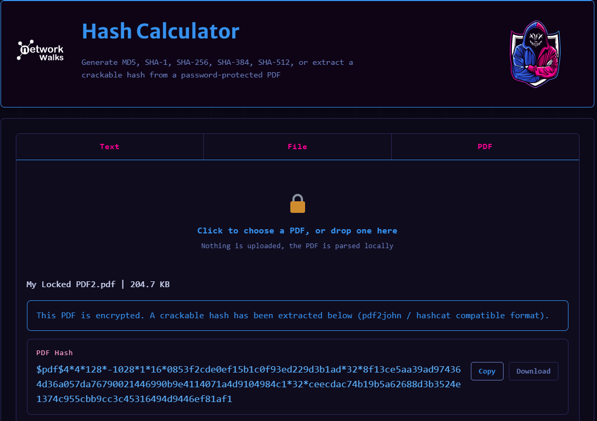
*Figure 12: Networkwalks Hash Calculator extracting the hash for PDF 2.*

I pasted that hash into the Password Cracker and ran it.

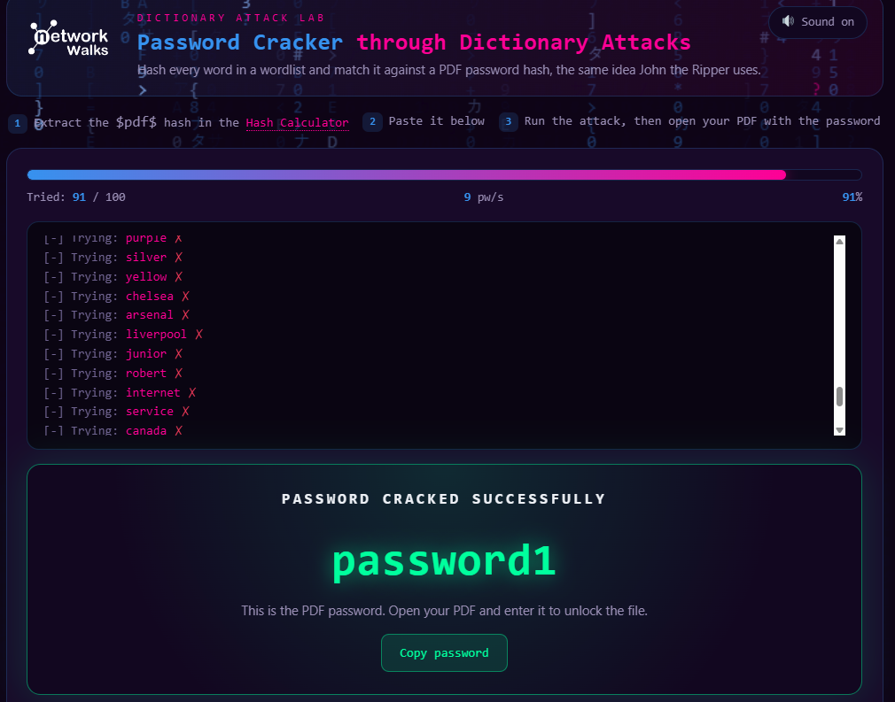
*Figure 13: Networkwalks Password Cracker finds `password1` for PDF 2.*

This matches the password Johnny found in PM1, and opened the same flag shown in Figure 8.

### PDF 3

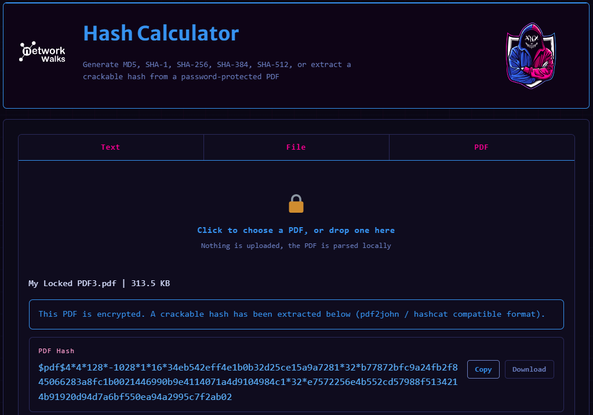
*Figure 14: Networkwalks Hash Calculator extracting the hash for PDF 3.*

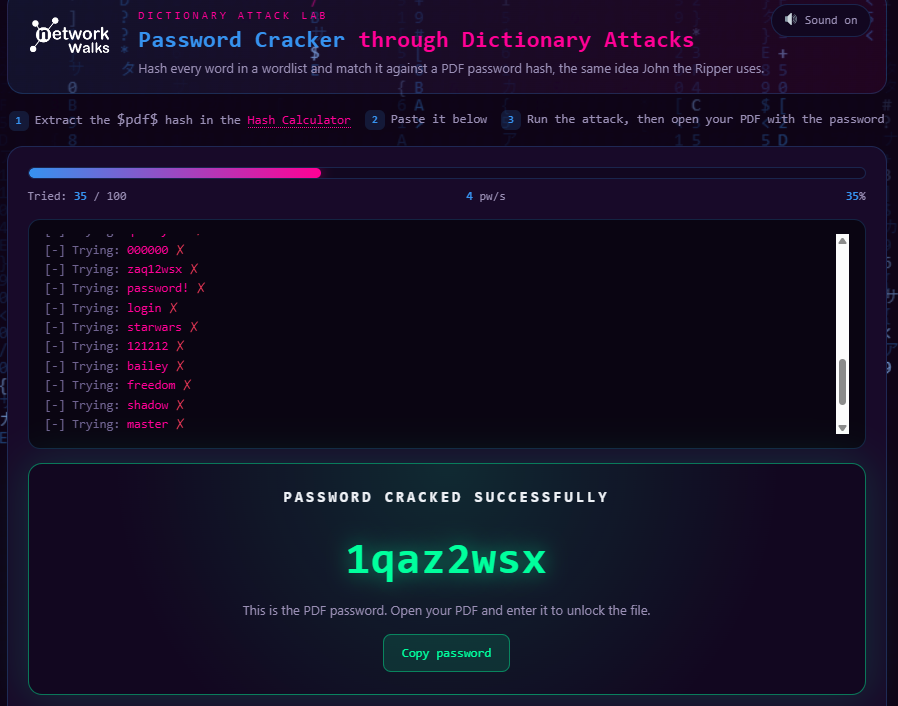
*Figure 15: Networkwalks Password Cracker finds `1qaz2wsx` for PDF 3.*

Again, this matches Johnny's result from PM1, and opened the same flag shown in Figure 11.

### PDF 1: not cracked with this tool

I tried the same steps against PDF 1, but the Networkwalks Password Cracker's built-in 100-word list never found `good-luck`. That's the key difference between the two modules: John the Ripper (with the jumbo wordlist it ships with) covers a much larger set of real-world passwords, while the Networkwalks tool's convenience list is intentionally small. `password1` and `1qaz2wsx` are both extremely common passwords that show up in almost any top-100 list; `good-luck` is a less typical pattern that a small built-in list simply doesn't include.

### PM2 Summary

| File | Tool | Password found? |
|---|---|---|
| My Locked PDF1.pdf | Networkwalks Password Cracker | ❌ Not in the built-in 100-word list |
| My Locked PDF2.pdf | Networkwalks Password Cracker | ✅ `password1` |
| My Locked PDF3.pdf | Networkwalks Password Cracker | ✅ `1qaz2wsx` |

##  What I Learned

- **A protected file's password is never stored directly** — only a hash derived from it, which is why extracting that hash is always the first step before any cracking tool can run.
- **Wordlist size and quality decide what gets cracked.** The same two passwords fell instantly to both tools, but the third needed John's larger jumbo wordlist. A cracking tool is only as good as the list behind it.
- **"Uncommon" doesn't mean "strong."** `good-luck` beat a 100-word list but is still a dictionary word pattern — it fell to JTR in seconds. None of these three passwords would survive a real attacker with a proper wordlist.
- **GUI tools like Johnny make JTR approachable**, but Johnny is only a front end — it still needs John's actual executable to do the work, which is why pointing it at the right path matters.
- **For a SOC analyst, this is the same judgment call behind a weak-credential alert.** A password surviving one quick automated check doesn't mean it's strong — it just means that particular check wasn't thorough enough. That's why real password policies get enforced with layered testing against multiple wordlists, not a single pass/fail tool.

## ➡️ Conclusion

All three PDFs were unlocked. John the Ripper, through Johnny, cracked every password; the Networkwalks tools cracked two of the three, missing only the one outside their smaller built-in list. The exercise made the gap between a convenience tool and a dedicated cracker concrete, and it's a clear argument for long, unpredictable passwords over short dictionary words — common or not.

> ⚠️ This lab used files provided for the internship, for learning purposes only.

---
